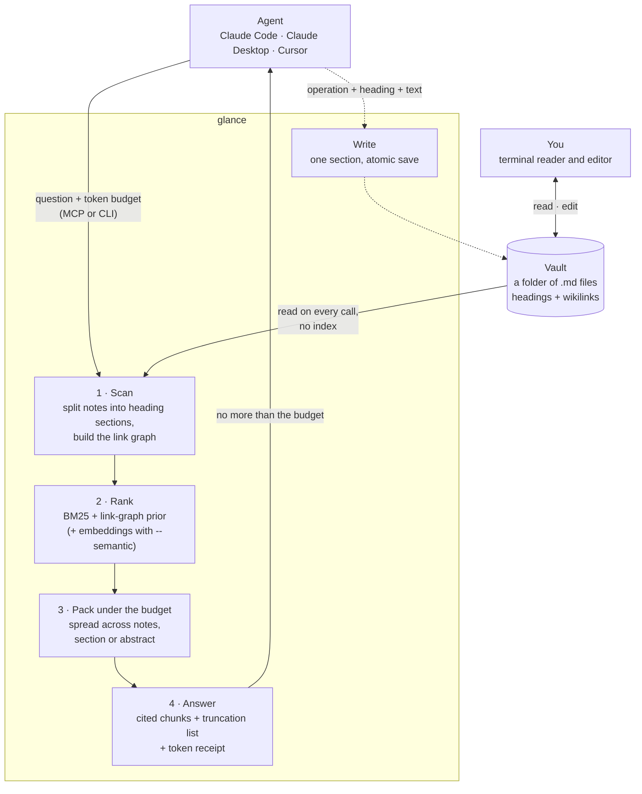

<p align="center">
  
</p>

<h1 align="center">glance</h1>

<p align="center">
  <b>A memory layer that lets your agent read a Markdown brain for a fraction of the tokens.</b><br>
  Local, written in C, no index to build. It is also a terminal reader and editor for the same files.
</p>

---

You keep a brain in Markdown: an Obsidian vault, an LLM wiki, a `memory/`
folder in a repo. Notes are split by headings and connected by `[[wikilinks]]`,
so the folder is really a graph. When an agent such as Claude needs one fact
from it, it usually greps and then loads whole files. That costs thousands of
tokens per question, and the agent never sees how the notes connect.

glance sits between the agent and the folder. The agent asks a question and
sets a token budget; glance returns the sections that answer it, each with a
citation, a list of what it left out, and a **token receipt** that says what
the lookup cost compared with reading the files.

## See it work

This repository keeps its own brain in [`memory/`](memory/MEMORY.md): five
notes, about 9,000 tokens. Ask it a question from a clone of the repo (with
glance [installed](#install), or after `make` as `./glance`):

```sh
glance --context "why is the default keyboard mode legacy?" memory/ --budget 400
```

```jsonc
// snapshot from 2026-11-18; scores and counts shift a little whenever the notes change
{
  "query": "why is the default keyboard mode legacy?",
  "budget_tokens": 400,
  "semantic": false,
  "chunks": [
    { "note": "lessons.md",
      "anchor": "The kitty keyboard stack can outlive the app (iTerm2)",
      "granularity": "section", "score": 16.537, "text": "…", "tokens": 156 },
    { "note": "decisions.md",
      "anchor": "2026-07-01 — Enhanced keyboard is opt-in; legacy stays the default",
      "granularity": "section", "score": 14.109, "text": "…", "tokens": 106 },
    { "note": "status.md", "anchor": "Status",
      "granularity": "abstract", "score": 7.231, "text": "…", "tokens": 56 },
    { "note": "history.md", "anchor": "History",
      "granularity": "abstract", "score": 6.811, "text": "…", "tokens": 52 }
  ],
  "truncated": [
    { "note": "lessons.md", "anchor": "Terminals encode Ctrl-chords three different ways",
      "score": 10.469, "tokens": 268 }
    // … 52 more sections, each with its anchor, score and token cost
  ],
  "receipt": { "used_tokens": 370, "raw_tokens": 9148, "saved_pct": 95 }
}
```

The agent gets the decision and the lesson behind it in **under 400 tokens
instead of about 9,000, a 95% saving**. Three things in that output matter:

- **`chunks`** are whole sections, not arbitrary text windows, and each one is
  citable as `note#heading`. glance first takes the best section from each
  matching note: the two that answer the question come back in full, and the
  status and history notes fit only as one-paragraph abstracts.
- **`truncated`** is the list of what did not fit. The budget never drops
  something silently: a second `lessons.md` section matched but did not fit,
  so it is listed, and the agent can fetch it with
  `glance --section "memory/lessons.md#Terminals encode Ctrl-chords three different ways"`.
- **`receipt`** compares the tokens used with the cost of reading every note
  in the folder you passed. Token counts are estimates from a byte and word
  heuristic, not a tokenizer.

glance fills the budget and stops, so the saving is set by the budget you
choose relative to the folder: about 95% at 400 tokens and 91% at 800 on this
9,000-token folder. What changes from question to question is whether the
right sections land inside the budget, and `truncated` is there for the times
they do not. The saving grows with the vault, because the budget stays fixed
while the raw read does not.

## How it works



1. **Scan.** The folder you pass is the vault. glance reads every `.md` file
   under it on each call, splits each note into sections at its headings, and
   resolves `[[wikilinks]]` into a graph. There is no index file and no setup
   step.
2. **Rank.** Sections are scored with BM25 and that score is fused with a
   prior from the link graph, so among the matching sections, those in notes
   linked to strong matches rank higher. `--semantic` fuses in an embedding
   score as well (see [Reads](#reads) for what ships today).
3. **Pack.** Retrieval is not top-k. glance fills the token budget, spreading
   it over several notes instead of spending it all on one, and it degrades a
   section to its abstract before leaving it out.
4. **Answer.** The result is JSON: the chunks with their anchors, the
   truncation list, and the receipt.

The same engine serves narrower reads (one section, an outline, a note's
neighbours in the graph) and a write path that changes one section at a time,
so the agent can keep the brain up to date as well as read it. Retrieval is
lexical and graph-based by default, which makes it deterministic and keeps it
on your machine. The rationale is in [docs/DESIGN.md](docs/DESIGN.md).

## Use it with Claude

Install glance first ([Install](#install)), then pick how the agent reaches it.

**MCP server.** `glance mcp` speaks JSON-RPC 2.0 over stdio and exposes every
read and write as a native tool.

```sh
claude mcp add -s user glance -- glance mcp     # Claude Code, every project
```

```json
{ "mcpServers": { "glance": { "command": "glance", "args": ["mcp"] } } }
```

The JSON form is for Claude Desktop, Cursor and other MCP clients. The tools
are `vault_context`, `vault_section`, `vault_outline`, `vault_neighbors`,
`vault_backlinks`, `vault_since`, `vault_links`, `vault_graph`, `vault_doctor`,
`vault_seed`, `vault_edit` and `vault_set_frontmatter`; the reference is
[docs/MCP.md](docs/MCP.md).

**Claude Code plugin.** This repository is also a plugin. It adds slash
commands for context, outline, links, graph and preview, and skills that
teach Claude to navigate a vault and preview Markdown through glance instead
of reading files raw. It calls your installed
`glance`.

```sh
claude plugin marketplace add LucaTamSapienza/glance
claude plugin install glance
```

**Plain CLI.** Any agent with a shell can call `glance --context …` directly.
One line in the repo's agent instructions is enough:

```markdown
To look something up in `memory/`, run
`glance --context "your question" memory/ --budget 2000` instead of reading whole files.
```

### Give a repo a brain

```sh
glance --seed [DIR]      # scaffold memory/ at the repo root, additively (DIR defaults to .)
```

`--seed` finds the repo root and creates `memory/`: an index that doubles as
the maintenance protocol, plus `status`, `decisions`, `lessons` and `history`
notes. It prints repo facts, a step-by-step **fill plan** for the calling
agent, a `wire_snippet` for the repo's agent instructions, and the done-check.
glance writes the structure and the agent fills in the knowledge; the brain is
ready when `glance --doctor memory/` exits 0. Existing files are never
touched, so re-running is safe.

## Agent commands

Every command prints JSON to stdout. `--context` and `--section` carry a token
receipt.

### Reads

```sh
glance --context "QUERY" DIR --budget N [--semantic]     # budgeted retrieval (above)
glance --section "FILE#Heading"        # one heading's subtree + a token receipt
glance --outline FILE [--depth N] [--abstract]           # heading tree, bounded
glance --neighbors "Note" DIR [--depth H]                # link-graph neighbourhood
glance --backlinks "Note" DIR [--context]                # who links here (+ the line)
glance --since TS DIR                  # notes changed after a Unix timestamp
glance --links FILE                    # a file's outbound links
glance --graph DIR                     # the whole vault's link graph
glance --doctor DIR                    # vault hygiene: oversized/stale/orphan/
                                       #   unreadable notes, dangling links, TODO
                                       #   markers; exit 0 clean / 2 findings
```

A cheap way to explore an unfamiliar vault is coarse to fine: `--outline` with
`--abstract` to see a note's structure, then `--section` for the one part that
matters, then `--neighbors` to follow the graph from there.

Always pass `--budget` to `--context`. It is optional, but the default is 0,
which means no cap: glance then returns every matching section, and because
sections nest that can cost more than reading the files.

`--semantic` fuses an embedding score into the ranking. The embedder that
ships today is a dependency-free word-hashing one, so it still needs shared
words. An on-device encoder that matches paraphrases, with a persistent
cache, is built on the `feat/semantic-minilm` branch (all-MiniLM-L6-v2) and
not yet merged.

### Writes

The agent states the operation and the heading; glance edits that section and
saves atomically (temp file + rename), preserving all other formatting. It
never rewrites a whole file.

```sh
glance --edit FILE append|insert|replace|before "Heading" "text"
glance --set-frontmatter FILE KEY VALUE
```

The heading is matched by text or slug, and headings inside fenced code are
ignored. `before` inserts the text immediately above the heading, which is how
to add a new entry to a dated, ordered log.

## Also a reader for humans

The files your agent reads are the files you read. glance opens them in a
rendered terminal UI with syntax-highlighted code, aligned tables and inline
images, in three vi-style modes: Reader, Insert (`i`) and Split with a live
preview (`e`). It navigates the vault the way the agent does: `Enter` follows
a `[[wikilink]]`, `b` lists backlinks, `Ctrl-G` opens the graph explorer and
`Ctrl-P` a fuzzy file switcher.

```sh
glance notes.md                   # the terminal reader and editor
glance notes.md --ui              # a read-only native preview window (macOS, Linux)
glance --export notes.md out.pdf  # themed HTML or PDF
cat notes.md | glance             # render to stdout
```

Themes, the macOS and Linux preview, "Open With" integration and every key
binding are in
[docs/READER.md](docs/READER.md); `glance --help` prints the full usage.

## Install

Requires a C11 compiler, [md4c](https://github.com/mity/md4c),
[notcurses](https://github.com/dankamongmen/notcurses), and `pkg-config`:

```sh
brew install md4c notcurses pkg-config
git clone https://github.com/LucaTamSapienza/glance
cd glance
make                 # builds both CLIs and build/Glance.app on macOS
make test            # unit tests (UBSan + AddressSanitizer where it can start)
make test-ui         # native preview integration test (macOS graphical session)
make install         # copy onto your PATH (/usr/local/bin; honours PREFIX/DESTDIR)
```

For a no-sudo install: `make install PREFIX=~/.local` (with `~/.local/bin` on your
`PATH`). The preview app is installed under `PREFIX/libexec/glance/Glance.app`
(`PREFIX/libexec/glance/glance-preview` on Linux).
`make uninstall` removes both binaries and the app. From a release archive, keep
`Glance.app` beside the `glance` executable. Building the app also requires the
macOS SDK / Command Line Tools (`xcode-select --install`).

## Why C, and why own the renderer

glance began as a Go program on the Charmbracelet stack (bubbletea + glamour),
and most of that code existed to work around glamour's opacity. It was
rewritten in C to own the whole pipeline:

```
Markdown ──▶ md4c (CommonMark/GFM) ─┬─▶ Doc ──────▶ ┌─ ANSI string      (CLI, tests)
                                    │   (lines of   ├─ notcurses cells  (TUI)
                                    │   styled runs)└─ projections      (agent reads)
                                    └─▶ HTML        (export, native preview)
```

Because glance builds the document model itself, the agent layer can project
the same note at any granularity (full text, one section, an abstract). That
is what makes packing under a budget possible, and a black-box renderer could
not do it. The human and the agent read through one parser, so what you see in
the reader is what the agent is given.

> The original Go implementation lives only in git history, at the
> **`go-final`** tag (`git checkout go-final`).

## Repository layout

```
src/            the C app: renderer + TUI (user-side) + the agent-memory layer
tests/          unit tests, one per pure module (make test)
testdata/       sample.md showcase + a small example vault/
memory/         the repo's own agent-curated memory (status · decisions · lessons · history)
docs/           DESIGN.md (agent-memory design) · MCP.md · READER.md · specs/ · archive/
.claude-plugin/ commands/ skills/   the Claude Code plugin
AGENTS.md       how to work in this repo, for humans and agents (CLAUDE.md imports it)
```

## Roadmap and known limitations

Agent-side: a bounded default for `--context` when no budget is given, and
merging the real semantic tier (an on-device encoder, a persistent `.glance/`
embedding cache and graph-expansion retrieval). It is built on
`feat/semantic-minilm` with all-MiniLM-L6-v2; the decided next step is to swap
the encoder for the multilingual EmbeddingGemma-300M. User-side: sharper inline images, the enhanced
keyboard protocol on by default (today `keyboard = enhanced` is opt-in),
remote-image fetch, wide-table wrapping. The living list is
[memory/status.md](memory/status.md).

## License

MIT. Part of the glance project by Luca Tamburrano.
